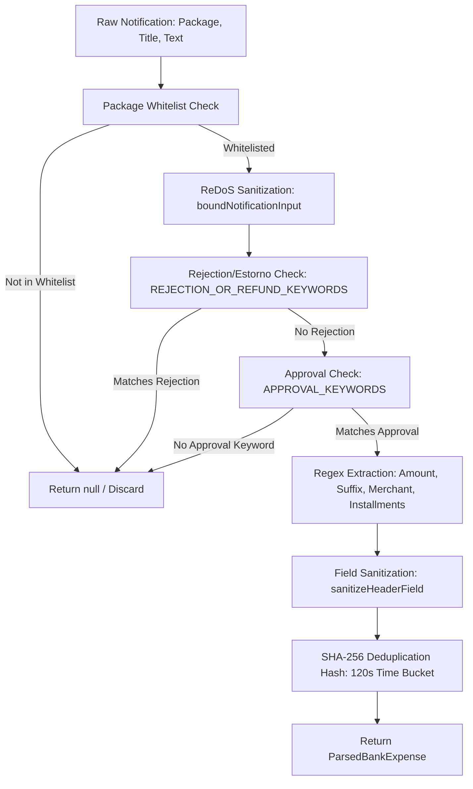

# Bank Notification Parser Skill

This skill guides adding and maintaining notification parsers in [BankNotificationParser.kt](../../../app/src/main/java/com/cardcontrol/app/service/BankNotificationParser.kt) and testing them in [SecurityAndDomainTestHarness.kt](../../../app/src/test/java/com/cardcontrol/app/SecurityAndDomainTestHarness.kt).

---

## 1. Core Architecture & Workflow

Every bank notification is processed through the following pipeline:



---

## 2. Step-by-Step Implementation Guide

### Step 1: Package Registration
Add package identifier to `SUPPORTED_PACKAGES`:
```kotlin
val SUPPORTED_PACKAGES = setOf(
    "com.nu.production",        // Nubank
    "br.com.intermedium",       // Inter
    "com.itau",                 // Itaú
    "com.itaucard.activity",    // Itaú Cartões
    "com.c6bank.app",           // C6 Bank
    "com.santander.app",        // Santander
    "br.com.santander.way",     // Santander Way
    "com.bradesco",             // Bradesco
    "br.com.bradesco.cartoes",  // Bradesco Cartões
    "br.gov.caixa.cartoes",     // Caixa Cartões
    "com.picpay",               // PicPay
    "com.mercadopago.wallet"    // Mercado Pago
)
```

### Step 2: Input Bounding (ReDoS Protection)
Always wrap incoming title and text:
```kotlin
val safeTitle = SecuritySanitizer.boundNotificationInput(title)
val safeText = SecuritySanitizer.boundNotificationInput(text)
```
*Never run unbounded regex on raw system strings.*

### Step 3: Filtering Non-Purchase Events
- If the notification contains refund or rejection words (`"negada"`, `"recusada"`, `"estorno"`, `"estornada"`, `"cancelada"`), discard immediately by returning `null`.
- Ensure purchase keyword exists in lowercase: `"compra aprovada"`, `"compra no credito"`, `"transacao aprovada"`, etc.

### Step 4: Extraction Patterns
- **Amount (`AMOUNT_REGEX`):**
  Matches `R$ 1.250,50` or `R$ 49,90`.
  Replace dots and convert comma to dot (`toDoubleOrNull()`). Verify amount `> 0.0` and `<= 1_000_000.0`.
- **Card Suffix (`LAST_FOUR_REGEX`):**
  Matches `final 1234` or `cartão ****1234`.
- **Installments (`INSTALLMENTS_REGEX`):**
  Matches `em 3x` or `10x`. Validate with `SecuritySanitizer.validateInstallments(raw)`. Default is `1`.
- **Merchant (`MERCHANT_REGEX`):**
  Extract establishment name. Always sanitize with `SecuritySanitizer.sanitizeHeaderField(rawMerchant, maxLength = 40)`.

### Step 5: SHA-256 Deduplication Hashing
Banks frequently emit multiple push notifications for a single transaction. CardControl deduplicates transactions using a 2-minute (120s) bucket:
```kotlin
val timeBucket = timestamp / 120_000L
val hashInput = "$packageName|${lastFour ?: "0000"}|$cleanAmount|${merchant.lowercase()}|$timeBucket"
val dedupHash = sha256(hashInput)
```

---

## 3. Mandatory Unit Testing

Whenever a parser pattern is added or updated, add test methods in `SecurityAndDomainTestHarness.kt`:

1. **Positive case:** Valid push notification matches expected amount, merchant, and installments.
2. **Declined/Canceled case:** Notification with "negada" or "estorno" must return `null`.
3. **Spoofing case:** Unofficial package (e.g., `com.whatsapp`) with identical text must return `null`.
4. **Boundary case:** Odd installment division or massive string inputs.

Run validation:
```powershell
powershell -ExecutionPolicy Bypass -File .agents/skills/cardcontrol-verify/scripts/verify.ps1 -TestsOnly
```
