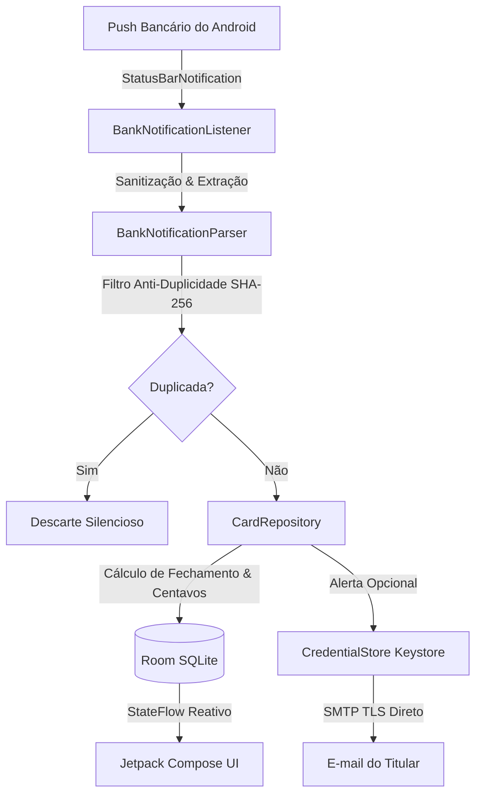

# Arquitetura e Engenharia Offline-First

O **CardControl** foi projetado com isolamento estrito de dados, persistência local atômica e zero telemetria.

---

## 1. Diagrama Geral de Fluxo

---

## 2. Componentes Principais

### Motor de Notificações (`com.cardcontrol.app.service`)
- **`BankNotificationListener`:** Herdeiro de `NotificationListenerService`. É notificado pelo sistema operacional sempre que um dos 9 pacotes suportados emite uma notificação na barra de status.
- **`BankNotificationParser`:** Motor com expressões regulares compiladas para extrair montante, estabelecimento, últimos 4 dígitos e quantidade de parcelas.
- **Deduplicação Inteligente:** Utiliza um hash SHA-256 (`package|lastFour|amount|merchant|timeBucket`) com janela de 120 segundos para evitar que pushes duplos emitidos pelo mesmo banco gerem compras duplicadas.

### Camada de Dados (`com.cardcontrol.app.data`)
- **`AppDatabase`:** Banco SQLite local criptograficamente privado ao sandbox do pacote (`com.cardcontrol.app`).
- **Tabelas do Room:**
  - `holders`: Cadastros de pessoas e seus sublimites.
  - `credit_cards`: Cartões com dias de fechamento, vencimento e titular padrão.
  - `transactions`: Registros mestre de despesas e hashes de deduplicação.
  - `installments`: Parcelas mensais calculadas individualmente com suas competências (`refMonth`, `refYear`).
  - `payments`: Registros de quitações e Pix para abatimento de saldo devedor.

### Precisão Financeira (`CardRepository.splitInstallmentAmounts`)
Divisões de parcelas em dízimas periódicas (ex: R$ 1.000 em 7x) utilizam `BigDecimal` com arredondamento `RoundingMode.DOWN`:
- 6 parcelas de R$ 142,85 (R$ 857,10).
- 1ª parcela de R$ 142,90 (absorvendo a sobra de R$ 0,05).
- Soma total = R$ 1.000,00 exatos.

### Cofre de Credenciais (`CredentialStore`)
- Utiliza `MasterKey` com algoritmo `AES256_GCM` amarrado ao chip de segurança físico do Android.
- As chaves de preferências são cifradas com `AES256_SIV` e os valores com `AES256_GCM`.
